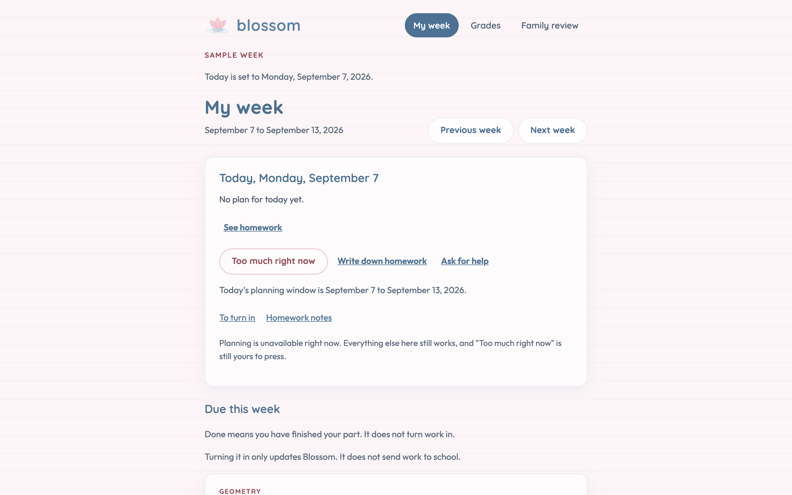
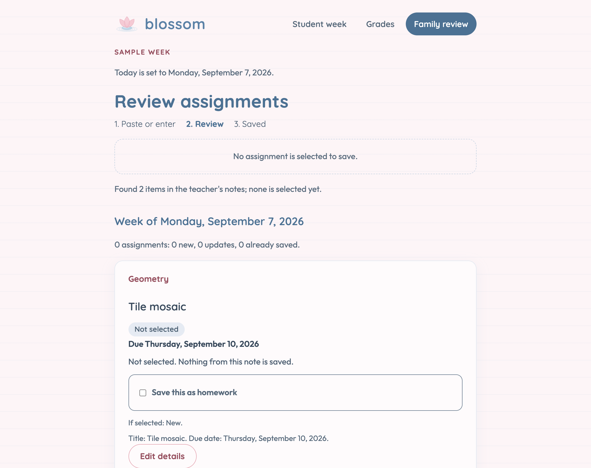
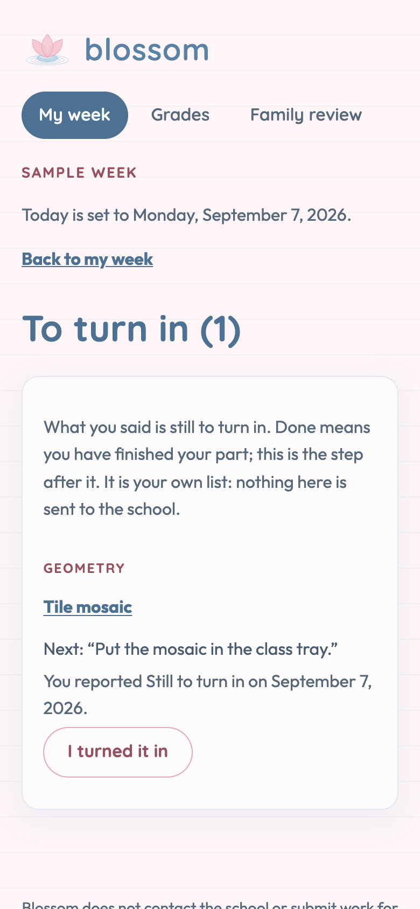

# Blossom

A homework tracker for the stretch between finding out what's due and actually
turning it in.

I'm building Blossom for my teenage daughter. She named it.
Sometimes all she brings home is a title, a date, and a note to check the
textbook. I want her to be able to write that down while she remembers it,
see what else is coming, and ask us for help when she needs it.

[Try the sample](#try-it-locally) · [Take a look](#a-look-inside) ·
[Run it for a household](docs/development.md#running-for-the-household)

<p align="center">
  <a href="docs/assets/student-week.png">
    
  </a>
</p>

*Her week starts here. She can write down what she remembers, even when
she doesn't have a date yet.*

## What works today

**See what's ahead.** My week brings together work due this week and work
assigned this week that's due later. She can open an assignment to read the
teacher's instructions. When dates disagree, she can see where they came from.

**Catch homework in her own words.** A homework note can wait until she knows
the class or the deadline. Later she or a parent can turn it into an
assignment or link it to one that's already there. Her original words stay
with the note.

**Make room for tonight.** With planning turned on, she can press
**Plan today** to set aside time for the work.
**Too much right now** asks for a shorter evening the next time she makes a
plan. She can start while a parent's review is still to come.

**Bring in what the school said.** A parent can enter one assignment or
paste **School text** in Family review. The review shows what Blossom read
and gives the family a chance to correct it and choose what to save.
If the teacher's note leaves Friday open as a possibility, a parent can
leave the deadline open too. With screenshot import turned on, a parent
can also choose screenshots of the school's homework list, check each
file's name and preview before anything is sent, and review what Blossom
read before saving.

**Check in together.** She can ask a parent for help from her week.
A parent can reply from Family review. On **Grades**, the family can look
at the results the school reported for a class and term. A parent brings
those in by pasting one class's grade report and checking it before Save.

## A look inside

### From a teacher's words to homework

<p align="center">
  <a href="docs/assets/school-text-review.png">
    
  </a>
</p>

*A teacher's note comes back with its words and a date to check.
The family chooses what to save.*

### Finished, with one thing left to do

<p align="center">
  <a href="docs/assets/to-turn-in.png">
    
  </a>
</p>

*The Geometry work is done. Putting it in the class tray is still on her list.*

She can mark an assignment **Done** when she finishes her part.
If it still needs handing in, she can leave herself a next step in
**To turn in**. It stays there across weeks. **I turned it in** records her
own account of what happened.

## Try it locally

The sample opens on Monday, September 7, 2026, with four made-up assignments.
You can try it without a school login or an API key.

You'll need Git and [uv](docs/development.md#installing-uv).
Blossom runs on Python 3.12 or 3.13. uv can install a supported Python
when it makes the environment.

From a local folder outside OneDrive or another sync service, get the code:

```bash
git clone https://github.com/gbodegas/blossom.git
cd blossom
```

Install the versions in the lockfile, then start the sample:

```bash
uv sync --locked
uv run --locked --env-file .env.example --env-file data/sample/sample.env uvicorn blossom.app:app --reload
```

Open [My week](http://127.0.0.1:8000/student/due-this-week) or
[Family review](http://127.0.0.1:8000/parent).
Look for **Sample week**. The first run creates its SQLite files under
`.local/sample/`. Changes you make will still be there when you restart.
Leave the terminal open while you're using Blossom. Press **Ctrl+C** to stop.

For a short tour, open the Geometry assignment in My week.
Choose **Done** and **Save update**, then **Other turn-in options**.
Choose **Still to turn in** and write where the paper needs to go.
After **Save hand-in update**, open **To turn in** to see the step you left.
The [sample guide](docs/development.md#the-sample-week) also walks through
asking a parent for help.

<details>
<summary>Windows PowerShell with Python and pip</summary>

Use the same clone above. Start in a fresh PowerShell window in the
Blossom folder.

**Install once.** Use Python 3.12, or use `py -3.13` on the first line
if you have Python 3.13.

```powershell
py -3.12 -m venv .venv
.\.venv\Scripts\python.exe -m ensurepip --upgrade
.\.venv\Scripts\python.exe -m pip install -e .
```

If there's no `py` launcher, use the
[guide's fallback](docs/development.md#other-ways-to-start-the-sample).

**Start the sample.** Paste this block from the Blossom folder each time.
It uses your settings file if you have one, then applies the sample's
paths and clock.

```powershell
$settingsFile = if (Test-Path .env) { ".env" } else { ".env.example" }

Get-Content $settingsFile, data\sample\sample.env |
    Where-Object { $_ -match '^\s*[A-Za-z_][A-Za-z0-9_]*=' } |
    ForEach-Object {
        $setting, $value = $_ -split '=', 2
        Set-Item -Path "Env:$($setting.Trim())" -Value $value.Trim()
    }

.\.venv\Scripts\python.exe -m uvicorn blossom.app:app --reload
```

Open My week or Family review at the links above. Start a fresh window
when switching from this sample to a household's settings.

</details>

## What leaves the computer

The week, homework notes, hand-in updates and School text review work
locally. Blossom doesn't contact the school, read email, submit homework
or send reminders.

Two optional features use a paid Anthropic API key:

- **Plan today** sends the work being planned, including applicable school
  instructions, assignment notes, her Not yet updates and planning context.
  Her original homework notes, requests for help and hand-in reports stay
  out of those calls. Planning prompts and responses are also kept locally.
- **Screenshot import** starts turned off. Choosing screenshots and
  previewing them happen in the browser and send nothing.
  **Upload without reading** stores them in Blossom and sends nothing to
  Anthropic. **Upload and read** sends the screenshots that upload added,
  **Replace and read** sends the one new screenshot, and **Read** on a
  screenshot review sends the unread screenshots that page names. The
  reader understands homework lists in the portal and print layouts it was
  built for. A parent checks the reading before saving assignments.

The [sharing guide](docs/development.md#what-the-planner-shares) explains
what goes into each call and what Blossom keeps afterward.

## Learn more

- The [development guide](docs/development.md) covers the sample, local setup
  and the tools for working on Blossom.
- [What the server serves](docs/development.md#what-the-server-serves)
  walks through the student and parent pages.
- [Running for the household](docs/development.md#running-for-the-household)
  covers your own records, time zone and separate sign-ins on the home network.
- [Upgrading and rolling back](docs/development.md#upgrading-and-rolling-back)
  explains how to keep a recoverable copy when you change versions.
- The [architecture notes](docs/architecture.md) explain how FastAPI serves
  the pages, SQLite keeps the records and LangGraph helps make a plan.

## Contributing

Bug fixes, tests and accessibility improvements are welcome.
Please use made-up schoolwork in examples, issues and screenshots.
For a larger feature, open an issue first. Blossom is built for one
household, and I want my daughter to have a say in what it becomes.

## License

The Blossom code is free software under the GNU Affero General Public
License, version 3 or later (`AGPL-3.0-or-later`). Keep the copyright and
license notices when sharing a copy. If you run a modified version for
other people over a network, offer them its corresponding source.
Blossom has a **Source code** link in the footer for this. Point
`SOURCE_URL` in [templating.py](blossom/templating.py) to your modified
source. The full terms are in [LICENSE](LICENSE).

The bundled fonts use the SIL Open Font License 1.1. Their notices travel
with the fonts. See the licenses for [Outfit](blossom/static/fonts/outfit-OFL.txt)
and [Quicksand](blossom/static/fonts/quicksand-OFL.txt).
